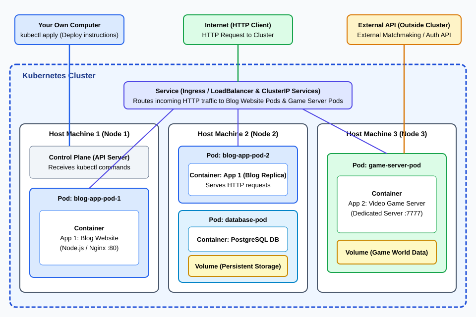
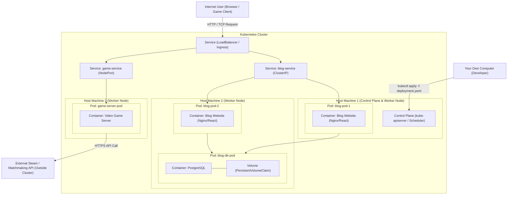

# Exercise 3.11: Kubernetes Cluster Architecture Diagram

Below is the Kubernetes architecture diagram showing:
- **Your Own Computer** sending deployment instructions via `kubectl` to the Kubernetes Control Plane API Server.
- **Internet User** sending `HTTP Requests` through the LoadBalancer / Ingress **Service** to the applications.
- **Kubernetes Cluster** with **3 Host Machines (Nodes)**:
  - **Node 1 (Control Plane + Worker)**: API Server and Blog Website **Pod** (**Container**).
  - **Node 2 (Worker Node)**: Blog Website **Pod** + Database **Pod** backed by a persistent **Volume**.
  - **Node 3 (Worker Node)**: Video Game Server **Pod** (**Container**) communicating with an external Matchmaking API outside the cluster.

